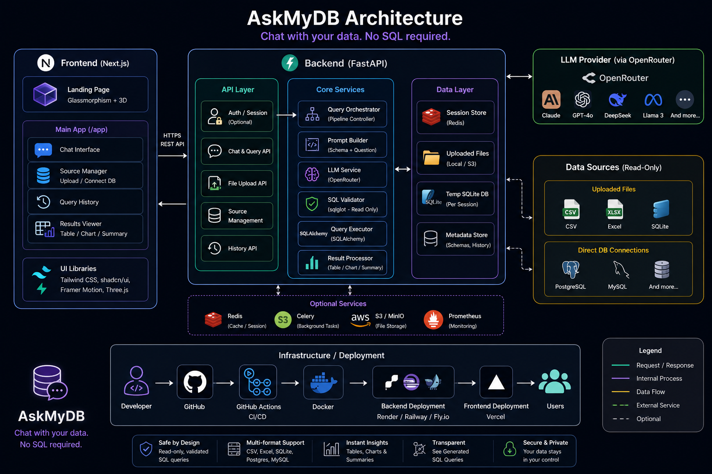

# AskMyDB 

AskMyDB is an AI-driven data assistant that lets you "talk" to your databases and data files in plain English. Upload a file or connect a live database, ask questions naturally (e.g., *"Show the top 10 customers by revenue this month"*), and get instant, safe SQL queries, interactive visualizations, and structured data results — no SQL knowledge required.



---

## ✨ Features

- **Natural Language to SQL**: Converts plain English into dialect-aware, read-only SQL queries powered by LLMs (OpenRouter).
- **Multiple Data Sources**:
  - File Uploads: CSV, Excel (`.xlsx`), JSON, and SQLite files.
  - Direct DB Connections: Connect to live PostgreSQL, MySQL, and SQLite databases via connection string.
- **Interactive Schema Explorer**: Live searchable sidebar inspecting tables, columns, and data types.
- **Multi-Type Visualizations**: Automatic chart type suggestion with instant switcher for **Bar**, **Line**, **Area**, and **Pie** charts (via Recharts).
- **Rich Data Table**: Searchable, column-sortable, and paginated query results with a **Fullscreen Modal View**.
- **Multi-Format Export**: Export query results to **CSV**, **JSON**, or formatted **Markdown table** (with one-click clipboard copy).
- **"Edit & Run" SQL Playground**: In-place query editor to tweak generated SQL and re-execute live against the active database.
- **AI Query Explanations & SQL Actions**: One-click SQL clipboard copy and step-by-step query explanation by the AI assistant.
- **Query History & Suggestion Chips**: Rapidly recall past queries and discover dynamic sample questions based on active schema.

---

## 🛠️ Tech Stack

- **Frontend**: Next.js 16 (App Router, Turbopack), React 19, TypeScript, Tailwind CSS, Recharts, Lucide Icons.
- **Backend**: FastAPI, SQLAlchemy, SQLite, Sqlglot (SQL validation & sanitization), Pandas, OpenRouter API.

---

## 🚀 Quick Start

### 1. Prerequisites
- Python 3.10+
- Node.js 18+ & npm
- An [OpenRouter](https://openrouter.ai/) API key

### 2. Backend Setup

```bash
cd backend

# Create & activate virtual environment
python -m venv venv
# On Windows:
.\venv\Scripts\activate
# On Linux/macOS:
source venv/bin/activate

# Install dependencies
pip install -r requirements.txt

# Configure environment variables
cp .env.example .env
# Edit .env and set your OPENROUTER_API_KEY

# Start backend server
uvicorn main:app --reload --port 8000
```

The API will be available at `http://localhost:8000` (docs at `http://localhost:8000/docs`).

### 3. Frontend Setup

```bash
cd frontend

# Install dependencies
npm install

# Start Next.js dev server
npm run dev
```

Open `http://localhost:3000` in your browser.

---

## 🔒 Security
All generated SQL runs through a strict validation and sanitization layer: only read-only `SELECT` queries are permitted, destructive operations (`DROP`, `DELETE`, `UPDATE`, `INSERT`, `ALTER`) are blocked, and automatic query limits are enforced.